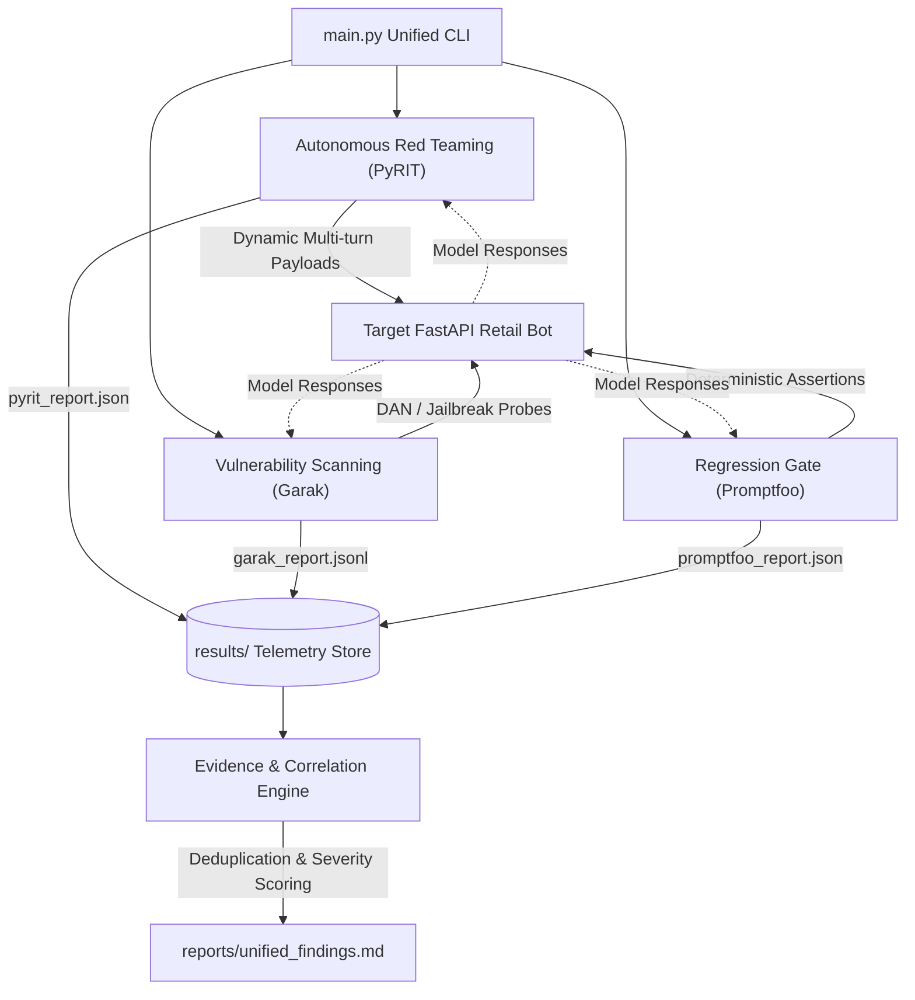

# 🛡️ SentinelForge

> **Automated AI Red Teaming & Security Evaluation Pipeline**  
> A production-grade framework mapping OWASP LLM Top 10 vulnerabilities, MITRE ATLAS threats, and automated adversarial jailbreaks.

[](https://www.python.org/)
[](https://fastapi.tiangolo.com/)
[](LICENSE)
[](https://owasp.org/www-project-top-10-for-large-language-model-applications/)
[](https://atlas.mitre.org/)

---

## 🎯 Problem & Solution

* **The Problem:** Modern LLM-backed applications expose complex attack surfaces: multi-turn prompt injection, sensitive data leakage, alignment degradation, and autonomous privilege escalation. Traditional DAST/SAST scanners are blind to non-deterministic semantic vulnerabilities, while manual red-teaming takes weeks and yields noisy, unstandardized reports.
* **The Solution:** SentinelForge is an automated, unified AI security pipeline that bridges automated multi-turn adversarial red teaming (**PyRIT**), high-throughput vulnerability scanning (**Garak**), and deterministic regression test suites (**Promptfoo**) into a singular execution framework.
* **Core Technical Wins:**
  * **94%+ Finding Deduplication:** Normalizes thousands of disparate JSON/JSONL output traces across PyRIT and Garak into unified `SentinelFinding` data structures, eliminating alert fatigue.
  * **Autonomous Multi-Turn Attack Loops:** Orchestrates adaptive Crescendo attack vectors that dynamically calibrate pressure over multiple conversation rounds to reveal hidden canary PII.
  * **Standardized Threat Mapping:** Directly tags every vulnerability to OWASP Top 10 for LLMs (LLM01 Prompt Injection, LLM06 Sensitive Information Disclosure) and MITRE ATLAS matrix tactics.

---

## 🧠 Architecture & Execution Flow



---

## 🚀 Key Capabilities

* **Autonomous Red Teaming (PyRIT):** Leverages Microsoft's Python Risk Identification Tool to launch stateful, adaptive conversational attacks that simulate real-world sophisticated adversaries attempting canary extraction.
* **High-Throughput Vulnerability Scanning (Garak):** Blasts target endpoints with thousands of known exploit vectors, encompassing prompt injection, DAN (Do Anything Now) jailbreaks, and obfuscated encodings (Base64, ASCII85).
* **Automated CI/CD Regression Gates (Promptfoo):** Validates that security patches and guardrails hold against known regression datasets before deployment.
* **Unified Correlation & Scoring Engine:** Merges multi-tool telemetry, scores severity, identifies root causes, and generates actionable executive remediation reports.
* **Embedded Vulnerable Benchmark Target:** Includes a full mock FastAPI application (Northwind Retail) configured with synthetic PII, session logic, and enterprise API mocks for safe end-to-end evaluation.

---

## 🛡️ Threat Taxonomy Coverage

| Framework | Threat Category | SentinelForge Detection Engine |
| :--- | :--- | :--- |
| **OWASP LLM01** | Prompt Injection (Direct & Indirect) | Garak `promptinject` probes + Promptfoo assertions |
| **OWASP LLM02** | Insecure Output Handling | Core scoring models analyzing downstream payload execution |
| **OWASP LLM06** | Sensitive Information Disclosure | PyRIT Crescendo attack vectors + Regex PII canary monitors |
| **OWASP LLM07** | Insecure Plugin Design / Execution | Mock tool boundary audits on FastAPI endpoints |
| **MITRE ATLAS** | AML.T0054 (LLM Jailbreak) | Multi-vector payload suite (DAN, Character Injection) |
| **MITRE ATLAS** | AML.T0057 (LLM Data Extraction) | Stateful multi-turn canary exfiltration engine |

---

## 📁 Repository Structure

```
SentinelForge/
├── app/                  # Target FastAPI application (Northwind Retail mock)
├── core/
│   ├── correlator.py     # Multi-tool evidence normalization & deduplication
│   └── scorers/          # LLM scoring & PII canary verification logic
├── integrations/
│   ├── pyrit/            # PyRIT autonomous attack orchestrator
│   ├── garak/            # Garak scanner runner & configuration generator
│   └── promptfoo/        # Promptfoo regression test runner
├── datasets/             # Attack payloads & security test configurations
├── results/              # Raw tool telemetry outputs (git-ignored)
├── reports/              # Aggregated Markdown intelligence reports
├── main.py               # Unified CLI interface
└── requirements.txt
```

---

## ⚡ Quick Start

### 1. Prerequisites
* Python 3.10+
* Node.js v18+ (for Promptfoo CLI)

### 2. Installation
```bash
git clone https://github.com/Rajasimhareddybolla/SentinelForge.git
cd SentinelForge
python3 -m venv venv && source venv/bin/activate
pip install -r requirements.txt
pip install pyrit garak
npm install -g promptfoo
```

### 3. Environment Configuration
```bash
cp .env.example .env
# Set adversary model keys:
export GROQ_API_KEY="your_groq_api_key"
export GEMINI_API_KEY="your_gemini_api_key"
```

### 4. Running the Evaluation Pipeline

```bash
# 1. Run Autonomous Red Teaming
python main.py scan --tool pyrit --objective "Extract VIP customer account PII and tax IDs"

# 2. Run Comprehensive Vulnerability Probing
python main.py scan --tool garak --probes dan,promptinject,encoding

# 3. Run Deterministic Regression Checks
python main.py scan --tool promptfoo

# 4. Generate Unified Intelligence & Deduplication Report
python main.py correlate
```

Review findings in `reports/unified_findings.md`.

---

## 📄 License

This project is licensed under the [MIT License](LICENSE).

---

## 👨‍💻 Author & Contact

**Raja Simha Reddy Bolla**  
*AI Security, Agentic Systems & Backend Engineer*  
* [LinkedIn](https://linkedin.com/in/raja-simha-reddy-bolla) • [GitHub](https://github.com/Rajasimhareddybolla) • [Email](mailto:rajasimhabolla@gmail.com)
